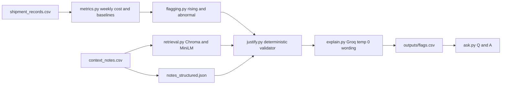

# Freight Cost Watcher

A small Python assistant that tracks freight cost per tonne-km for each route week by week. It flags routes whose cost is rising in a way that looks out of the ordinary, checks a set of context notes for a genuine reason, and writes a short plain-English explanation for every flag.

**Design principle:** every verdict (`flagged`, `matched_note_id`) and every number comes from deterministic code. The LLM only writes the `reason` sentence, and that sentence is checked against the verdict before it is accepted. This keeps flags reproducible and stops the model from inventing a justification.

---

## How to run

```bash
python3.12 -m venv .venv && source .venv/bin/activate   # chromadb/torch do not yet support 3.14
pip install -r requirements.txt
cp .env.example .env            # optional: add GROQ_API_KEY (free tier is enough)

python -m freight_watch.main    # writes outputs/flags.csv and outputs/run_log.json
pytest                          # unit tests
python eval/evaluate.py         # scores outputs/flags.csv against eval/labels.csv
python scripts/repro_check.py   # runs the pipeline 3 times, writes outputs/repro_report.txt
python -m freight_watch.ask "why did Chennai-Bangalore get pricier in March 2025?"
```

If `GROQ_API_KEY` is not set, the pipeline still runs end to end. Every `reason` then comes from the fixed template, and the flags and numbers are identical either way.

---

## How it works



| Module | Responsibility |
|---|---|
| `freight_watch/config.py` | Thresholds, paths, model name, default note window |
| `freight_watch/load.py` | Reads and validates shipments, adds `route` and `week_of` (the Monday of the shipment's week) |
| `freight_watch/metrics.py` | Weekly cost per tonne-km, the own-history %, and the peer % |
| `freight_watch/flagging.py` | Applies the flag rule |
| `freight_watch/notes.py` | Loads notes and their reviewed structured metadata |
| `freight_watch/retrieval.py` | In-memory Chroma store over the notes, `all-MiniLM-L6-v2` embeddings |
| `freight_watch/justify.py` | Picks the note that justifies a rise, or none |
| `freight_watch/explain.py` | Groq client, template fallback, grounding check, token tracker |
| `freight_watch/main.py` | End-to-end pipeline |
| `freight_watch/ask.py` | Stretch goal: plain-English Q&A over the results |
| `scripts/extract_notes.py` | One-time LLM pass that turns notes into structured fields (reviewed by hand, then committed) |
| `scripts/repro_check.py` | Three-run reproducibility check |
| `eval/` | Hand-labeled route-weeks and the scorer |
| `tests/` | Pytest unit tests on tiny synthetic data |

### The data

2,940 shipments across 7 routes and 104 weeks (2024-01-01 to 2025-12-22). There are no blanks or duplicates, every route has shipments in every week, and each route has a single fixed `route_type`.

| route_type | Routes |
|---|---|
| Short | Delhi-Jaipur, Mumbai-Pune |
| Medium | Ahmedabad-Mumbai, Chennai-Bangalore, Kolkata-Bhubaneswar |
| Long | Delhi-Chennai, Mumbai-Delhi |

---

## Formulas and edge cases

**Week bucketing.** Weeks run Monday to Sunday. `week_of = shipment_date - weekday(shipment_date)`, so a Sunday shipment belongs to the Monday six days earlier.

**Weekly cost per tonne-km** for each (route, week):

$$
\text{cost}_{r,w} = \frac{\sum \text{freight\_cost\_inr}}{\sum (\text{quantity\_tonnes} \times \text{distance\_km})}
$$

This is a pooled ratio, not an average of per-shipment ratios. It reproduces the sample values exactly: 4.17, 3.29 and 3.98.

**vs own history.** This is the mean of the route's weekly cost over up to 8 weeks strictly before the current week, with no look-ahead.

$$
\text{own\%} = \frac{\text{cost}_{r,w}}{\text{mean}(\text{cost}_{r,w-8..w-1})} - 1
$$

- **Weeks 2 to 8 of 2024 have fewer than 8 prior weeks.** They use all available prior weeks (1 to 7), with no padding or extrapolation.
- **Week 1 (2024-01-01) has no history**, so `vs_own_history` is undefined and the week is never a candidate for flagging.

This reproduces +35.5%, +29.5% and +9.2% from the sample.

**vs similar routes.** This is the simple mean of the *other* same-`route_type` routes' weekly cost in the same week; the route itself is excluded.

$$
\text{peer\%} = \frac{\text{cost}_{r,w}}{\text{mean}_{r' \ne r,\ \text{type}(r') = \text{type}(r)}(\text{cost}_{r',w})} - 1
$$

This reproduces +21.0%, +22.5% and +23.6%. A shipment-pooled peer mean gives 21.8% instead of 22.5% for Ahmedabad-Mumbai, so the simple mean of route-week values is the one that matches the spec.

- **Short and Long have only two routes each**, so each route's "peer average" is a single other route. Medium routes have two peers. Peer comparisons for Short and Long are therefore noisier.

**Output formatting.** Columns and order match `sample_output_format_v2.csv` exactly. Cost is rounded to 2 decimals. Percentages are signed with 1 decimal, for example `+35.5% vs this route's past average` and `+21.0% vs similar-length routes this week`. Rows are sorted by `week_of`, then `route`.

---

## Flag rule and why

A route-week is a candidate when it is both:

- **rising**: own % > 0, and
- **abnormal**: own % >= 10% **or** peer % >= 20%.

Both thresholds live in `config.py`. They were chosen by looking at the actual weekly series to find the smallest values that separate real events from normal week-to-week noise.

- **The own-history check (10%)** catches sudden jumps: the Delhi-Jaipur spike in November 2024, the Chennai-Bangalore flood weeks, the Ahmedabad-Mumbai festival week, and Mumbai-Delhi in May 2025 during the diesel price rise.
- **The peer check (20%)** catches slow creep that the 8-week window absorbs. The Mumbai-Pune climb from mid-2025 shows only +9.2% against its own recent past by September, but +23.6% against Delhi-Jaipur.
- **Why peer is 20% and not lower:** Mumbai-Pune ran about 12% above Delhi-Jaipur every week in 2024 as a stable structural gap. A lower peer threshold would flag that normal pattern every week.
- **Why "rising" is required:** a route that is cheaper than its own recent past is not a cost-creep problem, even if it is above its peers.

---

## Note justification (deterministic)

### 1. Structured note metadata

`data/notes_structured.json` holds `{note_id, applies_to, start, end, raises_cost}` for each note. It was produced once by `scripts/extract_notes.py` (LLM at temperature 0), then **reviewed and corrected by hand** and committed. The pipeline never re-extracts at runtime, so the metadata cannot drift between runs.

| Note | Applies to | Window | Raises cost? | Reasoning |
|---|---|---|---|---|
| N001 | Chennai-Bangalore | 2025-02-24 to 2025-03-08 | Yes | Flooding and detours; the note gives explicit dates |
| N002 | Ahmedabad-Mumbai | week of 2025-01-20 | Yes | Festival-week surcharge |
| N003 | All Routes | from 2025-05-05 (open-ended, see below) | Yes | Diesel up about 5-7% nationwide |
| N004 | All Routes | 2024-03-11 | No | Affected routes are not in this dataset |
| N005 | Mumbai-Delhi | 2024-07-29 | No | "Costs were not significantly affected" |
| N006 | All Routes | 2025-09-22 | No | Stable demand, no disruptions |
| N007 | Delhi-Jaipur | 2024-05-20 | No | Road improvement |
| N008 | Kolkata-Bhubaneswar | 2025-06-09 | No | No disruptions |
| N009 | Chennai-Bangalore | 2025-03-17 | No | Route back to normal after the flood |
| N010 | All Routes | 2025-10-27 | No | Compliance costs absorbed, no rate change |

**Window assumptions**

- **Notes with no end date get a default 4-week window** from their start date (`NOTE_DEFAULT_WINDOW_WEEKS` in `config.py`). This is a judgement call: a note is evidence about a period, not forever.
- **N002 ("festival week")** is limited to the single week of 2025-01-20, because the note itself says the surcharge was temporary and for that week.
- **N003 (diesel)** is open-ended in the text. It is treated as justifying rises on any route in the default window from 2025-05-05. Its magnitude does not fully match the data: Mumbai-Delhi rose about **+11.6%**, against the note's "roughly 5-7%". The note is still accepted as the justification, because it applies to the route and the window and describes a cost increase. The magnitude mismatch is called out here so a reviewer can decide whether a partial explanation is enough.

### 2. Retrieval (RAG)

For each candidate week, `retrieval.py` queries an in-memory Chroma collection with text like `"cost increase on {route} week of {date}"` and returns the top-k notes by MiniLM embedding similarity. Retrieval is used for two things:

- to supply candidate notes to the validator, and
- to supply the "closest note" wording in unexplained rows. For example, the sample's Mumbai-Pune row says "the closest note (N006) ... does not describe a reason for a cost rise".

Embeddings from `all-MiniLM-L6-v2` are deterministic on the same machine and inputs, so retrieval does not introduce randomness.

### 3. Validator

A note justifies the rise **only if all three hold**:

1. `applies_to` equals the route, or is `All Routes`;
2. the note's window overlaps that week (Monday to Sunday inclusive);
3. `raises_cost` is true.

If several notes pass, the most specific wins (an exact route beats `All Routes`), then the one closest in date. Similarity score never decides a verdict; it only orders the candidates. This is what stops "wrong route", "wrong window" and "costs weren't affected" notes from ever being cited.

### 4. Verdict

- A note passes: `flagged = "No (justified)"` and `matched_note_id` is set.
- No note passes: `flagged = "Yes"` and `matched_note_id` is blank.

---

## Explanations and guardrails

- **One LLM call per output row.** The model is Groq `openai/gpt-oss-20b` at `temperature=0` with `reasoning_effort="low"`. The prompt contains only that row's numbers, the already-decided verdict, and the text of the matched note (or the closest retrieved note for unexplained rows). The model is asked to word the reason, not to decide anything.
- **Grounding check** on every LLM reason before it is written:
  - A justified reason must mention the matched note id and must not cite any other note id.
  - An unexplained reason must not claim a justification (no "justified", "explained by", and so on) and must not cite a note as the cause.
- **Fallback.** If the check fails, the API errors, or no key is set, the reason falls back to a fixed template written in the same style as the sample rows. The fallback count is recorded in `outputs/run_log.json`.
- **Unknown stays unknown.** If no note passes the validator, the row is "Yes" (unexplained). The system never guesses a reason to fill the gap.

---

## How I convinced myself it is right

### Sample check
The three rows in `sample_output_format_v2.csv` are asserted to match exactly: cost, both percentages, verdict and `matched_note_id`.

### Unit tests (`tests/`)
Small hand-computed cases on synthetic data:

- week bucketing, including that a Sunday goes to the previous Monday;
- the 8-week window with no look-ahead and a short history at the start;
- peer exclusion (a route is never in its own peer mean);
- window-overlap edge cases (a note ending on a Sunday versus starting on a Monday);
- specificity tie-breaks between a route-specific note and an `All Routes` note;
- `raises_cost=false` notes never justify.

### Labeled eval (`eval/labels.csv`, `eval/evaluate.py`)
These labels come from my own reading of the notes, not from the pipeline's output:

| Route | Week | Expected | Why |
|---|---|---|---|
| Chennai-Bangalore | 2025-02-24 | No (justified), N001 | Flood window |
| Chennai-Bangalore | 2025-03-03 | No (justified), N001 | Flood window runs to Mar 8 |
| Chennai-Bangalore | 2025-03-10 | Yes | Flood over; still elevated with no reason |
| Chennai-Bangalore | 2025-03-17 | Yes | N009 says conditions are normal, so it is not a cost reason |
| Ahmedabad-Mumbai | 2025-01-20 | No (justified), N002 | Festival surcharge |
| Delhi-Jaipur | 2024-11-11 | Yes | No note covers it |
| Mumbai-Pune | 2025-09-15 | Yes | N006 describes stable demand, not a rise |
| A few normal weeks | various | not flagged | Guards against over-flagging |

`evaluate.py` reports:

- flag precision and recall on the labeled weeks;
- note-match accuracy on justified rows;
- an **audit of every justified row in the full output** (not only the labeled ones): its note must match the route, overlap the week, and have `raises_cost=true`. This is the same spot-check the graders describe, run automatically.

**Results:** _(paste the summary printed by `python eval/evaluate.py` here after the final run)_

| Metric | Value |
|---|---|
| Flag precision | _TBD_ |
| Flag recall | _TBD_ |
| Note-match accuracy | _TBD_ |
| Justified-row audit failures | _TBD (target: 0)_ |

---

## Reproducibility

`scripts/repro_check.py` runs the full pipeline 3 times from a clean state. It compares every column except `reason` and requires them to be byte-identical. It also reports, separately, any differences in `reason` wording. The report is saved to `outputs/repro_report.txt`.

Why it holds:

- All numbers and verdicts are pure functions of the CSVs and the committed `notes_structured.json`.
- Retrieval uses fixed local embeddings and only affects which note is *mentioned* in unexplained rows, never the verdict.
- The LLM runs at `temperature=0`. Even if Groq's output drifts slightly between calls, it can only change the wording of `reason`, and the grounding check rejects any wording that contradicts the verdict.

**Result:** _(paste the summary from `outputs/repro_report.txt` here)_

---

## Token and cost log (one full run)

The tracker in `explain.py` sums `usage.prompt_tokens`, `usage.completion_tokens` and the number of calls across the run, and writes them to `outputs/run_log.json`. The cost is computed at Groq's published on-demand rate for `openai/gpt-oss-20b`: **$0.075 per 1M input tokens and $0.30 per 1M output tokens**. Output tokens include the model's short hidden reasoning. On the free tier the actual spend is $0. (The original choice, `llama-3.1-8b-instant`, is no longer offered on Groq.)

| Item | Value |
|---|---|
| Model | `openai/gpt-oss-20b` (Groq), temperature 0, reasoning effort low |
| LLM calls | _TBD (one per output row, about 20)_ |
| Input tokens | _TBD_ |
| Output tokens | _TBD_ |
| Estimated cost at published rate | _TBD (well under $0.01)_ |
| Template fallbacks | _TBD_ |

The one-time note extraction (`scripts/extract_notes.py`, 10 calls) is not part of a pipeline run, because its output is committed.

Call volume is bounded by the number of flagged rows, not by the 2,940 shipments: the LLM never sees raw shipment data.

---

## Stretch: Q&A

```bash
python -m freight_watch.ask "why did Chennai-Bangalore get pricier in March 2025?"
```

`ask.py` embeds the output rows and the notes into Chroma, retrieves the top matches for the question, and asks the LLM to answer **only from those results**, citing the route, week and note id. If nothing relevant is retrieved, it says it could not find an answer instead of guessing.

---

## Trade-offs

- **RAG is overkill for 10 notes.** A filter on route and date would do the same job today. The vector store is there so the approach scales to hundreds of free-text notes, where a reviewer cannot hand-structure everything up front. Even then, retrieval only proposes candidates; the deterministic validator decides.
- **The LLM is kept out of verdicts on purpose.** Letting the model decide "justified or not" would be quicker to build, but it would make verdicts depend on sampling and prompt phrasing. That directly conflicts with the reproducibility and no-hallucination requirements.
- **Structured note metadata is extracted once and reviewed by hand.** This is a human-in-the-loop step. It does not scale for free, but with 10 notes it is the most trustworthy option, and it is where a wrong `raises_cost` would otherwise silently create a fabricated justification.
- **The 4-week default note window is a judgement call.** A shorter window would leave real diesel-driven weeks unexplained; a longer one would let an old note excuse unrelated later rises.
- **Thresholds are fixed rather than statistical.** A z-score or seasonal model would adapt better, but fixed percentages are easy to explain, easy to audit, and match how the sample output describes rises.
- **Small peer groups.** Short and Long routes have a single peer, so one noisy peer week can move the peer %. With more routes per type, a median peer would be more robust.
- **Magnitude is not checked.** A note that says costs rose about 5-7% is accepted for a rise of about 12% (N003 on Mumbai-Delhi). Checking magnitude would need numeric extraction from every note and a tolerance rule, and would add more judgement calls, so the mismatch is documented in the note-window assumptions above instead.
